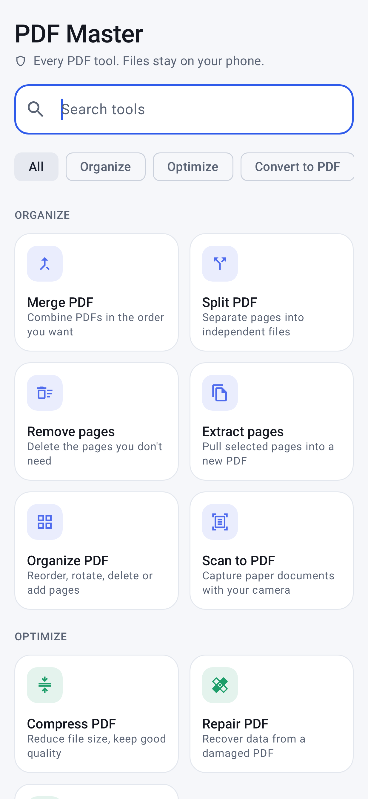
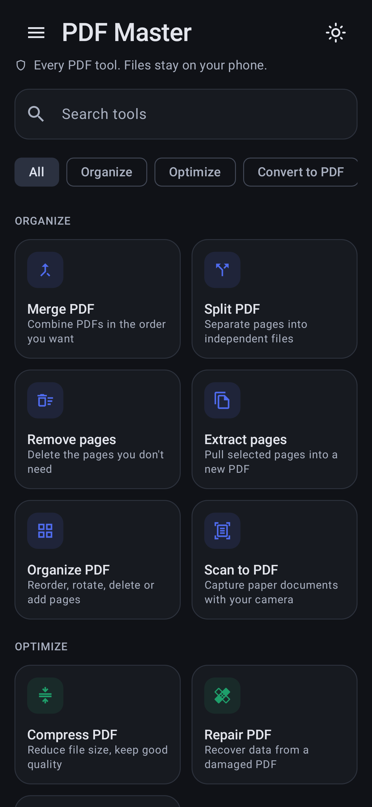
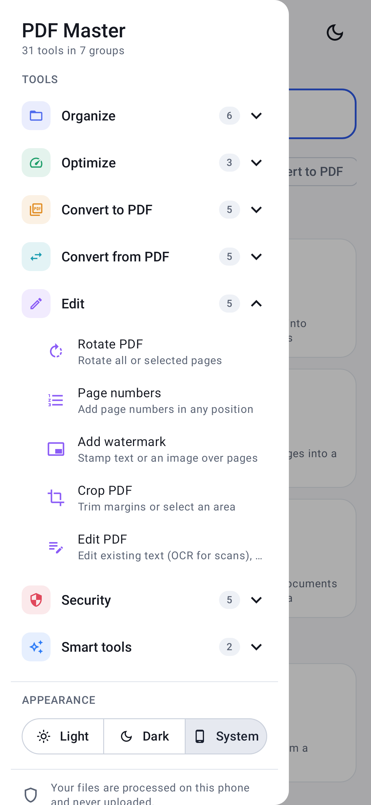
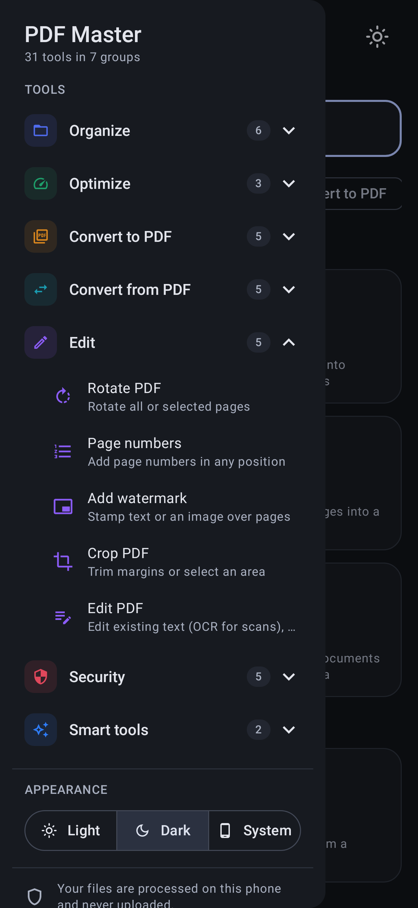

# PDF Master

A minimal Android app with a full set of PDF tools. Everything runs **on the device**: files are never uploaded.

   

## Install

Download the APK for your phone from [`apk/`](apk/) and open it (allow "Install unknown apps" when asked):

| File | For |
|---|---|
| `PDFMaster-1.2.0-arm64-v8a.apk` | Almost every phone from 2017 onwards |
| `PDFMaster-1.2.0-armeabi-v7a.apk` | Older 32-bit phones |

Requires Android 8.0 or newer.

## iPhone / iPad (web app)

The same tools run as an installable web app in [`web/`](web/) — no App Store needed:
open **https://shekath.github.io/pdfmaster/** in Safari → Share → **Add to Home Screen**.
It works offline after the first visit. A self-hostable copy is in [`dist/`](dist/). See [web/README.md](web/README.md).

## Tools (31)

| Category | Tools |
|---|---|
| Organize | Merge · Split (ranges / every page / every N) · Remove pages · Extract pages · Organize (reorder, rotate, delete, duplicate, blank pages, insert from another PDF) · Scan to PDF (auto edge detection, optional OCR) |
| Optimize | Compress (3 levels) · Repair · OCR (searchable PDF and/or text) |
| Convert to PDF | JPG/PNG/WebP → PDF · Word (DOCX, TXT, RTF) → PDF · PowerPoint (PPTX) → PDF · Excel (XLSX, CSV) → PDF · HTML / web page → PDF |
| Convert from PDF | PDF → JPG/PNG (pages or embedded images) · PDF → Word (editable or exact look) · PDF → PowerPoint · PDF → Excel (table detection) · PDF → PDF/A |
| Edit | Rotate · Page numbers · Watermark (text or image, tiled or centered) · Crop · Edit (**edit existing text**, with automatic OCR on scanned pages; add text, drawing, highlight, white-out, shapes, images) |
| Security | Sign (draw or type, plus date) · Redact (true redaction, with find-and-redact) · Unlock · Protect (AES-256 and permissions) · Compare (line-by-line diff and report) |
| Smart | Summarize (offline extractive summary and key terms) · Translate (ML Kit on-device, 50+ languages) |

The side menu (☰) lists every tool by category and has a Light / Dark / System appearance switch. You can also share PDFs, images and Office files *to* PDF Master from other apps. Any result can be passed straight into another tool ("More tools").

## Limits worth knowing

- Office → PDF uses a built-in renderer: text, headings, lists, tables and images come through, but complex layouts (columns, charts, SmartArt) are simplified. Legacy `.doc/.xls/.ppt` must be saved as the newer format first.
- PDF → Office: "Editable" mode rebuilds text and detects simple tables; "Exact look" places page images.
- PDF/A adds identification, XMP metadata and an sRGB output intent; use a validator (e.g. veraPDF) when strict compliance matters.
- Translation downloads each language model (~30 MB) once; HTML → PDF needs internet for the page. Everything else works offline.
- OCR languages: English and other Latin-script languages (built in), Hindi, Marathi, Nepali and Sanskrit (Google ML Kit via Play services, with a Tesseract fallback), and Bengali, Assamese, Gujarati, Punjabi, Odia, Tamil, Telugu, Kannada, Malayalam and Urdu (Tesseract; about 6–12 MB of language data downloads once per language). Choose the language in the OCR tool, in Scan to PDF, from "OCR page" in the editor, or in the side menu.
- Edit text: on PDFs with a real text layer the original words are removed and rewritten in place (Roboto font, matching size, colour and weight). On scanned pages the line is covered with the sampled background colour and new, searchable text is written on top.
- Scan to PDF uses Google Play services' document scanner.

## Build

```bash
./gradlew :app:assembleRelease      # APKs in app/build/outputs/apk/release/
./gradlew :app:testDebugUnitTest    # engine + UI tests (Robolectric)
```

A `release-keystore.jks` in the project root (git-ignored) is used for signing if present; otherwise the debug key is used.

Built with Kotlin, Jetpack Compose, [PdfBox-Android](https://github.com/TomRoush/PdfBox-Android) (Apache 2.0), Google ML Kit, [Tesseract4Android](https://github.com/adaptech-cz/Tesseract4Android) (Apache 2.0) and Noto fonts (SIL Open Font License 1.1, bundled in `app/src/main/assets/fonts`).
